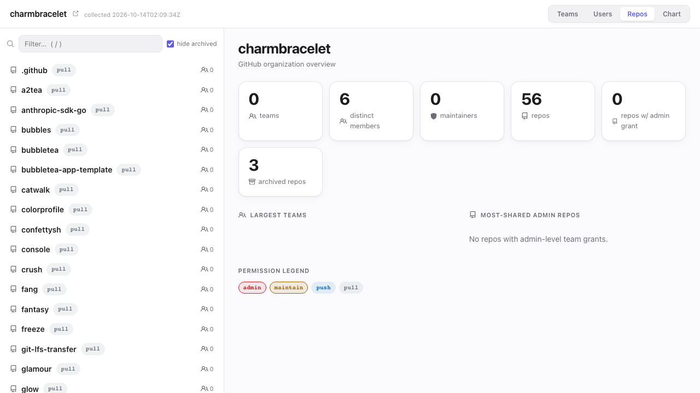

<div align="center">

# gh-org-view

**See who can touch what in a GitHub organization.**

A `gh` extension that collects an org's teams, members, repos, and CODEOWNERS<br>
into one JSON file and renders it as a self-contained, offline HTML explorer.

[](https://github.com/jackchuka/gh-org-view/actions/workflows/test.yml)
[](https://github.com/jackchuka/gh-org-view/releases)
[](https://goreportcard.com/report/github.com/jackchuka/gh-org-view)
[](LICENSE)

<picture>
  <source media="(prefers-color-scheme: dark)" srcset="assets/demo-dark.png">
  
</picture>

[Installation](#installation) · [Quick Start](#quick-start) · [Usage](#usage) · [Output](#output)

</div>

---

GitHub spreads access information across team pages, repo settings, and CODEOWNERS files in each repository. Answering "which teams can push to this repo?" or "what does this person have admin on?" means clicking through all of them.

**gh-org-view** gathers it in one pass and gives you a single page to browse by team, user, or repo, with each grant's permission level. The data lands in a plain JSON file you can edit, script against with `jq`, or publish as a static site.

> [!NOTE]
> This is a permission and ownership view, not a management org chart. GitHub teams reflect access grouping, not reporting lines.

## Features

- **Four views** — Teams (as a parent/child tree), Users, Repos, and a collapsible Chart of the team hierarchy
- **Permission-aware** — every team and direct-collaborator grant shows its level: `admin`, `maintain`, `push`, `triage`, `pull`
- **Member roles** — org owners vs. members, team maintainers vs. members
- **CODEOWNERS attribution** — scans `CODEOWNERS`, `.github/CODEOWNERS`, and `docs/CODEOWNERS` in admin/maintain repos and maps paths to teams
- **Fast navigation** — `/` to filter, arrow keys to move, Esc to clear; every view and entity has a shareable URL hash
- **Offline and self-contained** — one HTML file with the data embedded, light and dark themes
- **Cached and editable** — the JSON is reused for 24 hours, and hand edits survive re-runs until `--refresh`

## Installation

```bash
gh extension install jackchuka/gh-org-view
```

Requires the [GitHub CLI](https://cli.github.com/) authenticated with the `read:org` scope:

```bash
gh auth refresh -s read:org
```

Teams, team membership, and repo collaborators are only visible to members of the organization. On orgs you do not belong to it still works, but shows public repos only.

<details>
<summary><b>From source</b></summary>

```bash
git clone https://github.com/jackchuka/gh-org-view.git
cd gh-org-view
go build -o gh-org-view .
gh extension install .
```

</details>

## Quick Start

```bash
gh org-view my-org
```

This collects the org (or reuses a cache newer than 24 hours), writes the explorer, opens it in your browser, and prints a summary:

```text
org-view for my-org (freshly collected)
  teams:                  12
  repos:                  84
  owned repos:            61
  members:                37
  member entries:         95
  codeowner attributions: 140
  html:                   /tmp/gh-org-view/my-org-org.html
```

## Usage

```bash
gh org-view <org> [flags]
```

| Flag              | Description                                                          |
| ----------------- | -------------------------------------------------------------------- |
| `--refresh`       | Force re-collection, ignoring the cache                              |
| `--no-codeowners` | Skip the CODEOWNERS scan (faster on large orgs)                      |
| `--no-members`    | Skip collecting team members                                         |
| `--json`          | Print the canonical JSON to stdout; skip HTML render and open        |
| `--no-open`       | Render the HTML but do not open a browser                            |
| `--out-dir <dir>` | Write `index.html` and `org.json` into `<dir>` (implies `--no-open`) |

### Examples

```bash
# Large org: skip the per-repo CODEOWNERS scan
gh org-view my-org --no-codeowners

# Which repos does the "platform" team administer?
gh org-view my-org --json \
  | jq -r '.teams[] | select(.slug == "platform") | .repos[] | select(.permission == "admin") | .name'

# Build a static site in CI (for example, to publish with GitHub Pages)
gh org-view my-org --refresh --out-dir ./site
```

## Output

Files are written to `${TMPDIR:-/tmp}/gh-org-view/`:

| File             | Contents                                                |
| ---------------- | ------------------------------------------------------- |
| `<org>-org.json` | Canonical data; the 24-hour cache, safe to edit by hand |
| `<org>-org.html` | Self-contained explorer with the data embedded          |

The JSON has this shape:

```json
{
  "org": "my-org",
  "collected_at": "2026-01-01T00:00:00Z",
  "teams": [
    {
      "slug": "platform",
      "name": "Platform",
      "description": "",
      "parent": null,
      "members": [{ "login": "octocat", "role": "maintainer" }],
      "repos": [
        {
          "name": "my-org/api",
          "archived": false,
          "permission": "admin",
          "codeowner_paths": ["/deploy/"]
        }
      ]
    }
  ],
  "repos": [
    {
      "name": "my-org/api",
      "archived": false,
      "fork": false,
      "collaborators": [{ "login": "hubot", "permission": "push" }]
    }
  ],
  "members": [{ "login": "octocat", "role": "admin" }]
}
```

`repos[].collaborators` lists only direct grants (a user added to the repo itself, not through a team).

## Development

```bash
go test ./...
go build -o gh-org-view .
```

## License

[MIT](LICENSE)
